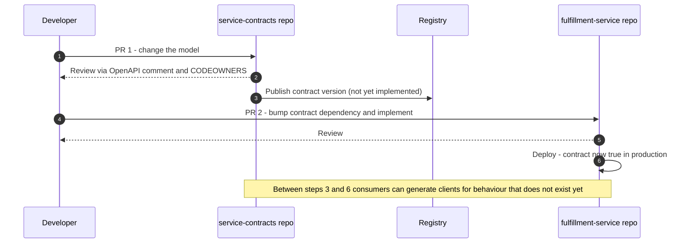
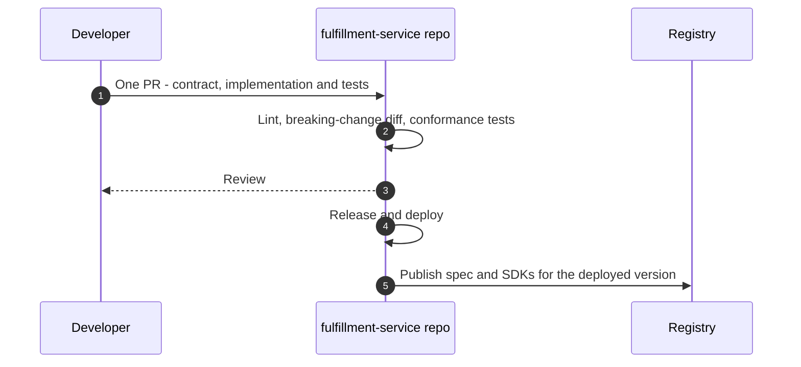
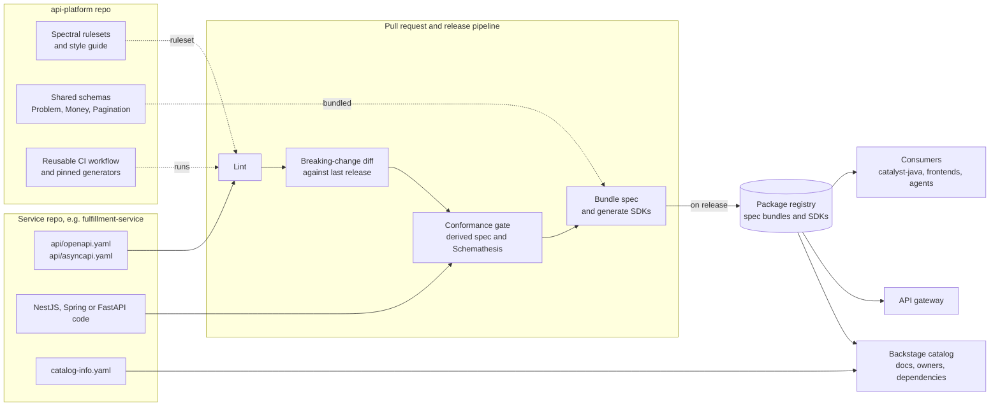
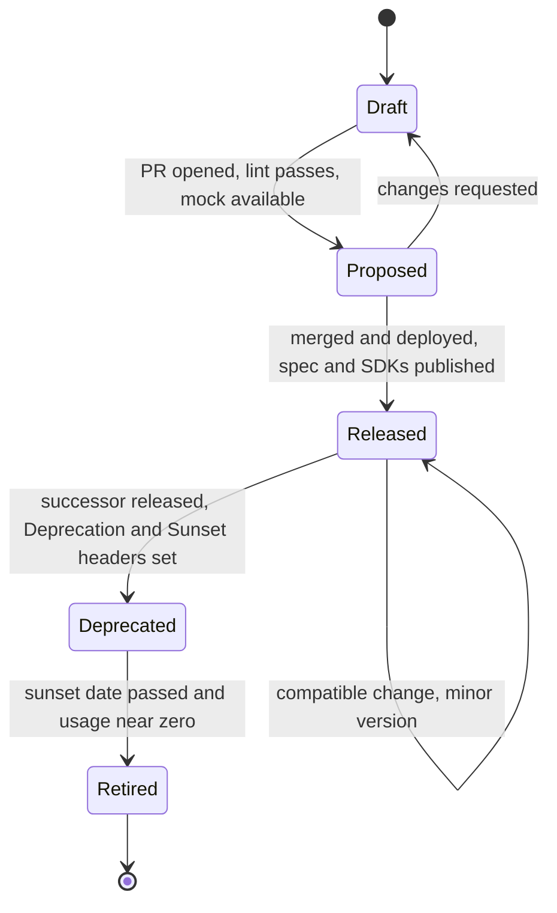

# API Contract Strategy for Andino Labs

**An independent evaluation of the `service-contracts` + Smithy proposal and the service-ownership rebuttal**

| | |
|---|---|
| **Prepared** | 24 September 2026 |
| **Context** | `#ai-engineering` thread on the Catalyst/Accelerator services `fulfillment-service` and `currency-exchange-bff` |
| **Proposal author** | Ganesan (posted by Shab) |
| **Rebuttal author** | Seba Diaz |
| **Stack in scope** | TypeScript/NestJS, Java, Python, with room for client-driven technology choices |
| **Status** | Recommendation, written to seed five ADRs (Section 5.1) |
| **Evidence standard** | Maturity claims were checked against primary sources on the date above: project READMEs, protocol specifications, and package-registry metadata. See [Appendix B](#appendix-b--evidence-log) and [References](#references). |

---

## TL;DR

Both engineers are right, about different layers of the problem. The thread stalled because each position bundles several independent decisions into one.

| Decision | Ganesan | Seba | Recommendation |
|---|---|---|---|
| Where is a contract **authored and owned**? | Central `service-contracts` repo, with CODEOWNERS routing | In the repo of the service that implements it | **Seba.** Contract, implementation and tests change in one pull request. |
| How is a contract **distributed and consumed**? | Versioned artifacts published from the central repo | Not addressed | **Ganesan.** Publish versioned specs and generated SDKs to registries. Nobody copies a spec again. |
| What is the **canonical, governed artifact**? | Smithy source, OpenAPI generated for review and consumption | OpenAPI; converge on a single spec | **OpenAPI 3.1** for HTTP APIs, **AsyncAPI 3.x** for events. Every downstream tool (lint, diff, docs, gateway, catalog, codegen) runs on these. |
| Should Smithy be the org-wide **authoring language**? | Yes | Only if it passes explicit success criteria | **Not now.** Run a six-week, criteria-based bake-off: plain OpenAPI vs. TypeSpec vs. Smithy ([Section 5.9](#59-the-authoring-layer-bake-off)). |
| Cross-cutting documentation | Not addressed | C4 "System" repo | **Seba**, implemented through Backstage System and Domain entities plus a thin system repo, so relationships are derived from metadata instead of drawn by hand. |

**Six findings that should change the conversation:**

1. **The duplication problem is a distribution problem, not a location problem.** Consumers such as `catalyst-java` kept local copies because nothing was published. Publishing versioned artifacts fixes this wherever the contract is authored. The two companies most often cited for "central contract repos" run them as *read-only publication mirrors*: Google's `googleapis` repo says it contains *copies* of API definitions, and AWS's `api-models-aws` states its files are generated from other sources and it cannot accept pull requests.
2. **Seba's headline argument contains a conflation, but his underlying concern is stronger than the one he stated.** Sharing a repository is not sharing a contract, and CODEOWNERS can express ownership in any layout. What location really determines is *atomicity*, meaning whether contract and implementation change together, and *where conformance is verified*.
3. **Smithy's protocol-agnosticism is real but conditional.** AWS moved SQS and CloudWatch to new wire protocols with nothing more than an SDK upgrade. That works because AWS owns both the client runtimes and the server protocol stacks. Andino would own neither for NestJS, Spring or FastAPI. Smithy's own Python generator is labelled "should not be used in production", and none of its server generators plugs into Andino's three frameworks.
4. **The largest unaddressed risk in both positions is drift between spec and implementation.** A concrete example: Smithy's `restJson1` protocol defaults to epoch-seconds numbers for timestamps, requires an `X-Amzn-Errortype` header on errors, and serializes `bigDecimal` as a plain JSON number. Hand-written NestJS, Spring and FastAPI services do none of this by default. Without a conformance gate, generated clients will mis-parse responses from a currency-exchange service.
5. **The contract ecosystem is converging on OpenAPI and JSON Schema for AI-agent consumption,** through tool calling, MCP servers and API catalogs. Supplier risk is real in this space too: in May 2026 the most prominent commercial SDK generator (Stainless) closed to new customers. Keep the canonical contract in an open standard and treat generators as replaceable.
6. **Nobody discussed versioning, event contracts, catalogs or gateways,** and each of them changes the answer. Section 4 covers them.

**The blueprint in one line:** *author locally, verify continuously, publish centrally.* OpenAPI 3.1 contracts live in each service repo. A shared `api-platform` repo, grown out of Ganesan's pipeline, supplies the style guide, rulesets, shared schemas and reusable CI. Every pull request is linted, diffed for breaking changes and checked for conformance against the running implementation. Every release publishes the spec plus TypeScript, Java and Python SDKs to the package registry and the Backstage catalog.

---

## Table of Contents

1. [The Debate, Restated Precisely](#1-the-debate-restated-precisely)
2. [Repository Strategy](#2-repository-strategy)
3. [Smithy vs. OpenAPI](#3-smithy-vs-openapi)
4. [The Missed Factors](#4-the-missed-factors)
5. [Recommendation and Blueprint](#5-recommendation-and-blueprint)
- [Appendix A — Weighted Decision Matrix](#appendix-a--weighted-decision-matrix)
- [Appendix B — Evidence Log](#appendix-b--evidence-log)
- [References](#references)

---

## 1. The Debate, Restated Precisely

### 1.1 What was proposed, and what already exists

Ganesan's problem statement has three parts. Services maintain their OpenAPI YAML independently. Contracts are effectively duplicated across services. There is no straightforward way for another service, or a future frontend, to consume an API without hand-rolling a client.

His proposal: a `service-contracts` repository becomes the single source of truth. Contracts are modelled in Smithy, and OpenAPI is generated and published as versioned artifacts. His stated reasons are Smithy's protocol-agnostic model, generated Java and TypeScript clients today with more languages available, and the ability to model streaming operations.

The prototype is substantial, and that deserves credit. The repo is live. Both services' APIs are migrated and publishing. An end-to-end example PR covers auth, pagination, parameters and errors. `catalyst-java` has a staged PR to consume published specs instead of local copies. CI posts the generated OpenAPI as a PR comment, so reviewers do not need to read Smithy. CODEOWNERS routes each contract change to the owning team.

Seba's rebuttal asks to unbundle two proposals. **(1) Repository:** an exposed API has one true owner, the repo that implements it; the two services have different responsibilities and so should not share a contract. Cross-cutting material such as integration diagrams should live in a C4 "System" repo. **(2) Language:** protocol-agnosticism is appealing but rarely exercised; OpenAPI's mature ecosystem should weigh heavily. Smithy should be evaluated against explicit success criteria, and the team should converge on one spec whatever the outcome.

### 1.2 Four decisions, not two

| # | Decision | The question it answers | Ganesan | Seba |
|---|---|---|---|---|
| D1 | **Authoring location** | Where is the contract edited and reviewed? | Central repo | Implementing repo |
| D2 | **Distribution** | How do consumers obtain a specific version? | Published artifacts | Not specified |
| D3 | **Canonical format** | Which artifact do downstream tools and consumers rely on? | Generated OpenAPI in practice; Smithy in principle | OpenAPI |
| D4 | **Authoring language** | What do engineers actually type? | Smithy | OpenAPI |

Ganesan's problem statement, duplicated specs and hand-rolled clients, is **fully solved by D2 alone**. Look at the `catalyst-java` change: it switches from local copies to published artifacts, and it would work exactly the same whether those artifacts were published from a central repo or from each service's own release pipeline. D1, D3 and D4 are separate choices with separate trade-offs, and they should not ride on D2's obvious merit.

### 1.3 Two conflations worth naming

**Repository sharing is not contract sharing.** Seba argues that two services with different responsibilities should not share a contract. The proposal doesn't ask them to. It co-locates two *separate* contracts in one repository, with per-path CODEOWNERS, which Ganesan already configured. The literal argument misses. The concern behind it survives in a stronger form, covered in [Section 2.4](#24-testing-the-core-arguments): contracts that live apart from their implementation cannot change atomically with it, and conformance becomes somebody else's problem.

**Multi-language SDKs are not a Smithy differentiator.** Ganesan presents generated clients in Java, TypeScript, Python and more as a benefit of Smithy. Multi-language generation is table stakes for OpenAPI, TypeSpec and Protobuf alike. What is genuinely Smithy-specific is (a) its richer semantic model, covering resources, standard pagination, open enums and unions, and built-in validators, and (b) protocol-agnosticism. Seba's reply blends the same two ideas when he says Smithy helps when we expect "multiple client languages/protocols". Multiple *languages* is a real Andino need that every option meets. Multiple *protocols* is the only part unique to Smithy, and it is the part least likely to be exercised.

---

## 2. Repository Strategy

### 2.1 The option space is wider than two choices

| Pattern | Authoring | Distribution to consumers | Real-world examples |
|---|---|---|---|
| **A. Central contract repo** (design-first) | One contracts repo; teams own paths through CODEOWNERS | Published from the contracts repo | Microsoft Azure REST API specs; Ganesan's proposal; many gRPC shops' "protos" repos |
| **B. Service-owned, copy-to-consume** | Each service repo | Consumers copy or vendor the spec | **Andino today**, which is the source of the problem |
| **C. Service-owned, registry-published** (federated) | Each service repo | CI publishes versioned specs and SDKs to a registry and a catalog | Backstage-style catalogs; Buf Schema Registry users; AWS and Google internally, with read-only public mirrors |
| **D. Organisation monorepo** | Everything in one repository | The build graph | Google internally |

Ganesan proposes **A**. Seba proposes **C** without saying how distribution works. The discussion is really about moving off **B**, and both A and C do that. The choice between them turns on second-order effects.

### 2.2 The strongest case for a central contract repo

- **Consistency by construction.** One place to review every API against the style guide, and one lint configuration.
- **One pipeline.** Linting, diffing, OpenAPI generation and SDK generation are configured once.
- **Discoverability.** Engineers browse one repository to see every contract.
- **Atomic cross-contract changes.** A shared type such as `Money` or `Problem` can be changed and regenerated everywhere in a single commit.
- **Design-first workflow.** Contracts can be agreed before any code exists, and consumers can build against mocks in parallel.
- **Toolchain isolation.** A JVM-based toolchain such as Smithy's never has to enter the build of a TypeScript or Python service.
- **Ganesan's mitigations already exist.** CODEOWNERS answers "who owns this contract", and the PR comment bot answers "who can review Smithy".

### 2.3 The strongest case for service-owned contracts

- **Atomicity.** Contract, implementation, tests and changelog change in *one* PR. The repository can never be in a state where the contract is merged but not implemented, or the reverse.
- **Local conformance.** The service's CI checks the implementation against the contract it ships, in the same run, with no version-pinning dance.
- **Release alignment.** Contract version and service release are the same event, so no mapping table is needed.
- **Autonomy without a queue.** Teams evolve APIs at their own cadence. Central review of every change is the classic bottleneck, and Netflix's experience below is the canonical example.
- **Agent and tooling locality.** IDEs, code search and AI coding agents operate on a single repository at a time ([Section 4.5](#45-ai-assisted-development)).
- **Smaller blast radius.** One broken model does not block every other team's publish.

### 2.4 Testing the core arguments

| Argument | Holds? | Assessment |
|---|---|---|
| "An exposed API has one true owner: the implementing repo" (Seba) | **Partly** | Ownership is a governance property, and CODEOWNERS expresses it in any layout. What *location* decides is atomicity and where conformance runs. That is the stronger version of this argument. |
| "Different responsibilities, so they shouldn't share a contract" (Seba) | **Does not apply** | Not proposed. Each service keeps its own contract. |
| "There is no central source of truth" (Ganesan) | **Yes** | But the source of truth that consumers experience should be the **published, versioned artifact in a registry**, not a Git repository. |
| "Contracts are duplicated across services" (Ganesan) | **Yes** | Solved by D2 (publish and depend on versions), independent of D1. |
| "A central repo makes cross-language SDK generation easy" (implied) | **Partly** | A reusable CI workflow gives every service repo the identical generation pipeline without centralising the contracts. |

### 2.5 One logical API change under each model

Take a single change: add an optional field to a `fulfillment-service` response.

**Central contract repo:**



**Service-owned, registry-published:**



The central model is workable, but it needs extra machinery the thread never mentioned. Contracts need lifecycle states such as *proposed* versus *live*. Pre-release versioning (`1.5.0-rc.1`) has to be applied until the implementation deploys. And a rule must stop consumers from depending on unreleased contracts.

### 2.6 Failure modes side by side

| Failure mode | Central contract repo | Service-owned + registry | Mitigation for either |
|---|---|---|---|
| Spec–implementation drift | **High.** Contract and code live apart. | **Low to medium.** Same PR, but still needs verification. | Conformance gate ([Section 4.1](#41-spec-implementation-conformance-the-biggest-blind-spot)) |
| Coordination cost | Two PRs per change, with ordering constraints | One PR | — |
| Lifecycle ambiguity | Is a merged contract live? | The contract is released with the deployment | Explicit lifecycle states |
| Style drift across teams | Low | **Medium to high** without shared tooling | Shared ruleset and reusable workflows |
| Discoverability | High | **Low** without a catalog | Backstage or another registry |
| Governance bypass | Hard | **Easy** unless checks are org-enforced | Organisation-level required workflows |
| Release coupling | Risk if the repo versions as a unit | None | Independent version per contract |
| Review bottleneck | Central reviewers become a queue | Distributed | Guild review only for breaking or new APIs |
| Build blast radius | One broken model blocks every publish | Isolated | — |

Every weakness of the service-owned model is fixable with shared tooling. The central model's top weaknesses, drift and coordination cost, are structural.

### 2.7 How industry leaders actually do it

**AWS.** Each service team owns its Smithy model. The public `api-models-aws` repository holds Smithy models for all public AWS services, but its README warns that the files are *generated from other sources* and that it cannot accept pull requests. It is a publication mirror, not the authoring source. AWS also supplies the strongest evidence for protocol-agnosticism. In 2023, SQS, a service generally available since 2006, added the AWS JSON protocol; customers only had to upgrade their SDK, and AWS measured up to 23% lower end-to-end latency. CloudWatch followed with JSON and CBOR support, which AWS reports gives 50–80% lower latency than the legacy Query protocol. *Lesson: model-driven SDK generation works at extreme scale, ownership stays with service teams, and the central repository is an output.*

**Google.** `googleapis/googleapis` holds the interface definitions of public Google APIs, and its README says it contains *copies* of them. The originals live with the code. One Protobuf definition serves both the REST/JSON and the gRPC versions of each API, and each major version gets its own directory, because the major version signals breaking change. *Lesson: Google gets multi-protocol flexibility from Protobuf, whose ecosystem is far larger than Smithy's outside AWS, and its central repo is an export.*

**Microsoft Azure.** This is the counter-example. `Azure/azure-rest-api-specs` *is* the authoring source for Azure REST API specifications. New API versions require an API Stewardship Board review. PRs carry required breaking-change checks and labels for versioning and breaking-change review. Brownfield services are being told they will soon have to convert to TypeSpec. SDKs are generated from the specs for Java, JavaScript, .NET, Python and Go, and some of those generation PRs are now opened by Copilot agents. *Lesson: central authoring works when there is a dedicated governance function and public multi-language SDKs are the product. Andino has neither today, and at its current scale should not build an Azure-style board.*

**Stripe.** Stripe publishes OpenAPI in `stripe/openapi` in two variants: public specs, and SDK specs carrying extra annotations and pre-release features used to generate its libraries. Since `2024-09-30.acacia`, Stripe ships monthly API versions with no breaking changes and a named release twice a year that can contain them. SDK minor versions follow the monthly releases and SDK majors follow the twice-yearly ones. *Lesson: versioning is a product capability tied to SDK release engineering, and one contract can be projected for different audiences.*

**Netflix.** Netflix's federated GraphQL platform went schema-first and deliberately decoupled its GraphQL schema from the Protobuf/gRPC layer, so the graph could evolve independently. Domain teams own their portions of the graph, which the gateway composes. Deprecated fields are removed only once per-field usage statistics show nobody uses them. Before federation, the central API team had become a *clearing house*: a bottleneck for models and dependencies. *Lesson: centralising contract ownership creates queues. Distribute ownership, and centralise composition, governance and usage telemetry.*

**Spotify (Backstage).** In Backstage's system model, APIs are first-class entities *implemented by components*, with public, restricted or private visibility. A System encapsulates components and resources, hides its private APIs, and exposes public ones. API definitions in OpenAPI, AsyncAPI, GraphQL or gRPC can be pulled by URL from the owning repository through `$text` substitution. *Lesson: store contracts where they are owned, and centralise discovery.*

**The Buf ecosystem.** The Buf Schema Registry replaces the old practice of copying `.proto` files between repositories. Producers publish modules. Consumers install generated SDKs with `npm install`, Maven, Gradle, `pip install`, `go get` and others. Breaking-change policies can be enforced *at the registry*. *Lesson: a registry is the modern answer to the distribution problem that central IDL repos were originally built to solve.*

| Organisation | Contracts authored | Central artifact | Governance mechanism | Transferable lesson |
|---|---|---|---|---|
| AWS | With service teams | Generated mirror (`api-models-aws`) | Smithy validation; SDK pipelines | Central repo as *output* |
| Google | With the code | Copies (`googleapis`) | API design guidance; major-version directories | Protobuf for multi-protocol |
| Azure | **Central repo** | The repo itself | Stewardship board; required breaking-change checks | Central works *with* a board |
| Stripe | Internal API definitions | Published OpenAPI | Release cadence; semver SDKs | Version the API as a product |
| Netflix | Domain teams (subgraphs) | Composed supergraph | Schema checks; usage-based deprecation | Avoid central bottlenecks |
| Spotify | Owning repos | Backstage catalog | Ownership metadata | Centralise discovery |
| Buf users | Producer repos | Buf Schema Registry | Registry-side policy | Registry replaces copying |

Six of the seven author contracts with the implementing team and centralise *publication and discovery*. The one exception, Azure, pays for central authoring with a formal review board.

### 2.8 Where Seba's C4 "System" idea fits

Seba's proposal matches the Backstage model closely. A Backstage **System** is a group of components and resources that exposes public APIs and hides private ones; a **Domain** groups systems that share a bounded context. That points to a concrete design:

- Each service repo declares its **Component** and **API** entities in `catalog-info.yaml`, including `providesApis` and `consumesApis`.
- A thin `system-catalyst` repo declares the **System** and **Domain** entities and holds the C4 context and container views as diagrams-as-code (Structurizr DSL or Mermaid), plus the ADRs for the system.
- Cross-service *flows*, such as "reserve inventory, quote the FX rate, then confirm the order", can be described as **Arazzo** workflows, the OpenAPI Initiative's specification for multi-step API sequences. Arazzo is machine-readable, testable, and useful to AI agents.
- **Guard against rot.** Hand-drawn integration diagrams go stale quickly. Relationship data should come from each service's catalog metadata, so the system view is *derived*, not maintained.

### 2.9 Verdict on repository strategy

**Adopt pattern C: service-owned authoring, registry distribution, shared platform tooling.** Ganesan's `service-contracts` repo does not disappear. It becomes `api-platform` and keeps the CI, the PR-comment bot, the CODEOWNERS conventions and SDK generation. It holds the *rules and shared building blocks*, not the service contracts ([Section 5.4](#54-repository-layout)).

---

## 3. Smithy vs. OpenAPI

### 3.1 What each one actually is

**OpenAPI** is a description format for HTTP APIs, written in JSON or YAML and governed by the OpenAPI Initiative under the Linux Foundation. Version 3.1 aligned its schema dialect with JSON Schema 2020-12. Version 3.2.0, published in September 2025, added first-class streaming (an `itemSchema` for sequential media types such as Server-Sent Events and JSON Lines), the `QUERY` method, hierarchical tags and the OAuth device flow. OpenAPI describes the wire: paths, methods, parameters, headers, media types and status codes. It is HTTP-specific by design, and that specificity is exactly why every gateway, documentation tool, mock server, test tool and catalog can consume it.

**Smithy** is an interface definition language and semantic model created at AWS, open source under Apache 2.0 and maintained in the `smithy-lang` GitHub organisation. AWS uses it to generate its SDKs. A Smithy model is made of *shapes* (structures, unions, enums, lists, maps, operations, resources and services) annotated with *traits*. A protocol is itself a trait on the service, such as `@restJson1` or `@rpcv2Cbor`. HTTP binding traits (`@http`, `@httpLabel`, `@httpQuery`, `@httpHeader`) are honoured by HTTP-binding protocols such as `restJson1` and ignored by RPC protocols. Smithy's FAQ names its own differentiators: a normalised model built for code generation, traits with built-in validation, protocol-agnosticism, multi-team ownership of one model, and projections that tailor a model for different audiences.

**TypeSpec** is not part of the debate, but it competes for the same role as Smithy: a concise authoring language that sits above the wire format. It is Microsoft's TypeScript-like API description language. The compiler reached 1.0 in May 2025, and its OpenAPI emitter, which produces OpenAPI 3.0 and 3.1, is one of the stable 1.0 components. Azure has made it the authoring language for `azure-rest-api-specs` (Section 2.7).

The crux of the whole thread: **OpenAPI describes an HTTP interface. Smithy describes a service, then binds it to one or more protocols.** Every argument on both sides follows from that difference.

### 3.2 The same operation, written both ways

Take one operation from `currency-exchange-bff`: list the exchange rates for a base currency, one page at a time.

**Smithy IDL 2.0**

```smithy
$version: "2"

namespace com.andino.catalyst.fx

use aws.protocols#restJson1

@restJson1
@title("Currency Exchange BFF")
service CurrencyExchange {
    version: "1.4.0"
    operations: [ListRates]
}

/// Lists exchange rates for a base currency, one page at a time.
@readonly
@http(method: "GET", uri: "/v1/currencies/{base}/rates")
@paginated(inputToken: "nextToken", outputToken: "nextToken", pageSize: "pageSize", items: "rates")
operation ListRates {
    input := {
        @required
        @httpLabel
        base: CurrencyCode

        @httpQuery("pageSize")
        @range(min: 1, max: 100)
        pageSize: Integer

        @httpQuery("nextToken")
        nextToken: String
    }

    output := {
        @required
        rates: RateList

        nextToken: String
    }

    errors: [CurrencyNotFound]
}

@pattern("^[A-Z]{3}$")
string CurrencyCode

list RateList {
    member: Rate
}

structure Rate {
    @required
    quote: CurrencyCode

    /// Decimal string such as "1.0842". Never a JSON number.
    @required
    rate: String

    @required
    @timestampFormat("date-time")
    asOf: Timestamp
}

@error("client")
@httpError(404)
structure CurrencyNotFound {
    @required
    message: String
}
```

**OpenAPI 3.1**

```yaml
openapi: 3.1.0
info:
  title: Currency Exchange BFF
  version: 1.4.0
paths:
  /v1/currencies/{base}/rates:
    get:
      operationId: listRates
      summary: Lists exchange rates for a base currency, one page at a time.
      x-pagination:            # Illustrative only. OpenAPI has no standard; each generator defines its own.
        inputToken: nextToken
        outputToken: nextToken
        items: rates
      parameters:
        - name: base
          in: path
          required: true
          schema:
            $ref: '#/components/schemas/CurrencyCode'
        - name: pageSize
          in: query
          schema: { type: integer, minimum: 1, maximum: 100 }
        - name: nextToken
          in: query
          schema: { type: string }
      responses:
        '200':
          description: One page of rates
          content:
            application/json:
              schema:
                type: object
                required: [rates]
                properties:
                  rates:
                    type: array
                    items: { $ref: '#/components/schemas/Rate' }
                  nextToken: { type: string }
        '404':
          description: Unknown base currency
          content:
            application/problem+json:
              schema: { $ref: '#/components/schemas/Problem' }
components:
  schemas:
    CurrencyCode:
      type: string
      pattern: '^[A-Z]{3}$'
    Rate:
      type: object
      required: [quote, rate, asOf]
      properties:
        quote: { $ref: '#/components/schemas/CurrencyCode' }
        rate:
          type: string
          pattern: '^-?\d+(\.\d+)?$'
          description: Decimal string such as "1.0842". Never a JSON number.
        asOf: { type: string, format: date-time }
    Problem:                   # RFC 9457 problem details; in practice shared from api-platform
      type: object
      properties:
        type: { type: string, format: uri-reference }
        title: { type: string }
        status: { type: integer }
        detail: { type: string }
        instance: { type: string, format: uri-reference }
```

| Aspect | Smithy | OpenAPI 3.1 |
|---|---|---|
| Size of this example | 67 lines, blank lines included | 66 lines. Length is not where the two differ; semantics are. |
| Pagination | `@paginated` is a standard trait that every Smithy generator understands, so clients get paginators for free | A vendor extension. Each generator has its own, such as Speakeasy's `x-speakeasy-pagination` or Fern's `x-fern-pagination`. |
| Operation semantics | `@readonly` and `@idempotent` are explicit and validated | Implied by the HTTP method, not enforced |
| Errors | Typed shapes attached to operations. How an error is identified on the wire is decided by the protocol. | Responses per status code, identified by the problem `type` URI if the organisation standardises on RFC 9457 |
| Timestamps | The protocol default applies unless `@timestampFormat` is set. In `restJson1` bodies the default is epoch seconds. | Written explicitly as `format: date-time` |
| Validation | `@pattern`, `@range`, `@length` and model validators run on every build | JSON Schema keywords, checked by linters and runtime libraries |
| What the reviewer approves | The Smithy source, plus the generated OpenAPI posted as a PR comment | The artifact consumers will actually use |

Two observations follow from the comparison.

**Smithy carries intent that OpenAPI can only approximate.** `@readonly` and `@paginated` are facts about the operation that every generator can act on. In OpenAPI they become conventions and vendor extensions, and SDK features end up depending on which generator you picked. This is a genuine advantage for SDK quality.

**The two most important lines for a currency service are the ones a Smithy author must remember to write.** Without `rate: String` and `@timestampFormat("date-time")`, the model is still valid, but it means something different on the wire: the rate becomes a JSON number and the timestamp becomes epoch seconds. OpenAPI has no hidden layer between the document and the wire. What the page says is what the wire carries.

### 3.3 Ecosystem comparison

| Dimension | Smithy | OpenAPI |
|---|---|---|
| Steward | AWS-led open source (Apache 2.0) | OpenAPI Initiative (Linux Foundation), multi-vendor |
| Current versions | IDL 2.0 | 3.1.x in wide use; 3.2.0 published September 2025, with tool support still limited |
| Toolchain runtime | JVM (Smithy CLI or Gradle plugin) | Any: Node, Go, JVM and Python tools all exist |
| Validation and linting | Built-in validators and configurable linters on every build | Spectral, Redocly CLI and others, with shareable rulesets |
| Breaking-change detection | `smithy-diff`, extensible with custom evaluators | `oasdiff`, with hundreds of checks graded ERR, WARN and INFO, plus changelog generation |
| Wire-level test cases | Built in: `@httpRequestTests` and `@httpResponseTests` traits define protocol test cases that generators turn into tests | Not part of the spec; runtime testing with Schemathesis, contract testing with Pact |
| Documentation portals | Through conversion to OpenAPI | Swagger UI, Redoc, Scalar, Backstage API docs and most commercial portals |
| Mock servers | Through conversion | Prism, Microcks and many others |
| API gateways | Amazon API Gateway integration traits; other gateways through conversion | Imported natively by Kong, Apigee, Azure API Management, AWS API Gateway, Tyk and others |
| Catalogs | No Backstage definition type; teams register the generated OpenAPI | Backstage `openapi` type; Apicurio Registry artifact type |
| Model distribution | Model packages resolved as Maven dependencies in `smithy-build.json` | Files, URLs, package registries or schema registries |
| Client generators | smithy-typescript, smithy-java and smithy-python, plus the Go, Kotlin, Rust and Swift generators behind the AWS SDKs (not assessed here) | openapi-generator (dozens of languages), Kiota, and many language-specific and commercial generators |
| Server integration | Generated server SDKs with their own runtimes | Code-first emission built into NestJS, Spring (springdoc) and FastAPI; server stubs from openapi-generator |
| Conversion | To OpenAPI (lossy) and JSON Schema; Disney's `smithy-translate` converts OpenAPI and JSON Schema to Smithy, and Smithy to Protobuf | To and from most formats; `tsp-openapi3` converts OpenAPI to TypeSpec |
| AI-agent tooling | smithy-java MCP server generation (developer preview) | Tool definitions use JSON Schema; many tools generate MCP servers from OpenAPI |
| Talent pool | Concentrated around AWS | Ubiquitous |

The lossy conversion deserves precision, because Ganesan's design depends on it. Smithy's own documentation calls the OpenAPI conversion lossy. Endpoint and host-label traits, prefix headers, non-RESTful routing and non-HTTP protocols are unsupported, and resource metadata and custom traits are dropped. None of that affects the two current APIs much. It does mean that the more of Smithy's richer semantics Andino uses, the more the published OpenAPI understates the real model, and every downstream tool sees only the OpenAPI.

### 3.4 Maturity for Andino's three languages

Every entry below comes from the project's own README or from package-registry metadata, checked on 24 September 2026.

| Language | Smithy clients | Smithy servers | OpenAPI clients | OpenAPI on the server |
|---|---|---|---|---|
| **TypeScript** | `smithy-typescript` labels the whole repository Developer Preview, with interfaces and platforms subject to change. Yet it generates the GA AWS SDK for JavaScript v3, and its client runtime (`@smithy/smithy-client` 4.15.2) is mature and active. | Server SDK packages are pre-1.0 (`@smithy/server-common` 0.4.2, `@smithy/server-node` 0.3.3, `@smithy/server-apigateway` 0.3.3) and target plain Node HTTP and API Gateway, not NestJS | `openapi-typescript` 7.13 with `openapi-fetch` 0.17; `@hey-api/openapi-ts` 0.99, which can also emit Zod schemas; `orval` 8.37; openapi-generator's TypeScript generators; Kiota (TypeScript in preview) | `@nestjs/swagger` 12.0.2 emits OpenAPI from decorators |
| **Java** | `smithy-java` client modules are declared stable and ready for production | Developer preview, on a Netty-based runtime, with `rpcv2-cbor` and `restJson1` server protocols | openapi-generator's Java clients; Kiota (Java stable) | springdoc-openapi emits OpenAPI at runtime; openapi-generator can generate Spring interfaces to implement |
| **Python** | `smithy-python` states its generator and the clients it generates are "unstable and should not be used in production systems yet". Its PyPI packages (`smithy-core` 0.8.1, `smithy-http` 0.5.0, `smithy-json` 0.3.0) are marked Pre-Alpha, as are AWS's first experimental Python SDK packages built on it, such as `aws-sdk-bedrock-runtime` 0.11.0. | None | `openapi-python-client` 0.29.1; Kiota (Python stable); openapi-generator's Python client; `datamodel-code-generator` 0.82 for Pydantic models | FastAPI (0.141.1) generates OpenAPI natively |

For TypeScript and Java, Smithy client generation is viable today, with the caveat that the TypeScript generator's interfaces may still change. Python, one of Andino's three languages, has no production-ready Smithy client, and no Smithy server generator plugs into NestJS, Spring or FastAPI.

The OpenAPI column has several usable options in every cell, but none of them is perfect either. openapi-generator's own README describes its OpenAPI 3.1 support as beta, and several popular TypeScript generators are still pre-1.0. The bake-off ([Section 5.9](#59-the-authoring-layer-bake-off)) should test the specific generators Andino would pin, rather than trust any maturity label, including the ones in this table.

### 3.5 Developer experience in practice

**Authoring.** Smithy is concise and strict. The model is validated on every build, so a whole class of mistakes, such as dangling references, invalid trait combinations or pagination members that don't exist, never reaches review. OpenAPI YAML is verbose and permissive, and without a linter it tolerates a lot. Authoring is where Smithy clearly wins, and the matrix in Appendix A scores it that way.

**Toolchain.** Smithy's build runs on the JVM. For Java teams that is invisible. For TypeScript and Python engineers it is a new runtime, a new build tool and a new failure mode on every laptop and CI runner. Containerising the build hides the JVM, but not the learning curve.

**Review what you merge.** Ganesan's CI comment, which posts the generated OpenAPI on each PR, is a smart mitigation. It still leaves a gap: reviewers approve a derived artifact while the merge applies the source, and traits such as `@timestampFormat` or `@jsonName` change the output in ways a reviewer only notices by reading the comment closely. A stronger variant works for any authoring language: commit the generated OpenAPI next to the source and make CI fail if it is stale. The contract diff then becomes part of the PR itself.

**Hidden protocol defaults.** This is the most practical concern. Three `restJson1` rules conflict with what Andino's frameworks do out of the box.

| Behaviour | `restJson1` rule | NestJS, Spring Boot and FastAPI defaults |
|---|---|---|
| Timestamps in JSON bodies | Epoch seconds as a JSON number unless `@timestampFormat` is set. Smithy's OpenAPI converter follows the protocol and documents these fields as numbers. | ISO 8601 strings (`Date#toJSON`, Spring Boot's Jackson configuration, Pydantic) |
| Error identification | New server implementations MUST send an `X-Amzn-Errortype` header. Clients accept that header, a `__type` body field or a `code` body field. | None of the three sends any of these by default |
| Decimals | `bigDecimal` is serialized as a plain JSON number, and the protocol specification itself warns that many JSON parsers truncate such values or cannot parse them | Depends on the serializer |

A Smithy-generated TypeScript or Java client talking to a hand-written NestJS, Spring or FastAPI service will therefore fail to parse any timestamp not explicitly annotated, and will fall back to a generic error for every modelled error. That is not a flaw in Smithy. It is what happens when a protocol designed for Smithy-generated servers is paired with servers written by hand. It is also exactly the drift the conformance gate in [Section 4.1](#41-spec-implementation-conformance-the-biggest-blind-spot) catches.

**Bus factor.** Smithy knowledge at Andino appears to be concentrated in the engineer who built the prototype. On its own that is not an argument against Smithy, since every tool starts with one champion. It is an argument for deciding on explicit criteria, including onboarding time, rather than on the strength of a prototype.

### 3.6 Testing the protocol-agnostic claim

| Scenario | What Smithy offers | What it would take at Andino | Strongest alternative |
|---|---|---|---|
| Move a JSON service to a binary protocol for latency | Add `@rpcv2Cbor` to the service and regenerate clients. The model doesn't change. | Every server must speak `rpcv2Cbor`: adopt smithy-java's developer-preview Netty server, or hand-build the protocol in NestJS and FastAPI. Python clients have no production generator. | Protobuf with gRPC or Connect, which has production servers and clients for Node, Java and Python |
| Bidirectional streaming, such as live FX quotes | Event streams are modelled in the IDL. Over `restJson1` they use `application/vnd.amazon.eventstream` binary framing, with a prelude and CRC32 checksums, and HTTP/2 for full duplex. | None of NestJS, Spring or FastAPI implements that framing, so every server would hand-build it. Browsers cannot do full-duplex streaming over `fetch`. | Server-Sent Events described in OpenAPI 3.2 for server push; WebSockets described in AsyncAPI; gRPC or Connect streaming between services |
| Serve REST and RPC from one definition | Attach several protocol traits to one service | A server implementation of each protocol, in each framework | Connect: one handler serves gRPC, gRPC-Web and the Connect protocol, which can use JSON over HTTP/1.1 |
| Change the IDL later | Conversion to OpenAPI is built in; `smithy-translate` goes from OpenAPI to Smithy and from Smithy to Protobuf | Cheap in either direction, *provided the canonical artifact stays OpenAPI* | TypeSpec imports OpenAPI with `tsp-openapi3` |

**Protocol-agnosticism is an option, and options have a price.** Its value is roughly the probability of actually switching protocols, times the payoff when that happens, minus the cost of carrying the option until then. At Andino the carrying cost is paid every day: the JVM toolchain, a niche skill set, an immature Python generator, and protocol defaults that don't match the frameworks. The payoff requires something Andino doesn't have, which is control of the server protocol stack in each framework.

**The AWS evidence cuts against both positions.** Seba frames protocol flexibility as mostly an early-stage benefit. The SQS change contradicts that: a service generally available since 2006 changed its wire protocol in 2023, and customers only had to upgrade their SDKs. The benefit is largest for *mature, high-volume* services. But the precondition is that the organisation owns both the client runtimes and the server protocol implementations, as AWS does. Ganesan is right that the benefit is real. Seba is right that Andino is unlikely to collect it.

### 3.7 Where OpenAPI is genuinely weaker

An honest comparison has to be explicit about OpenAPI's weaknesses, because the recommendation has to mitigate each of them.

| Weakness | Why it matters | Mitigation in the blueprint |
|---|---|---|
| No standard for pagination, waiters, retries or idempotency | Every generator invents its own extension, so SDK features vary by generator | Organisation-wide conventions in the style guide, shared pagination schemas, one pinned generator per language |
| Enums are effectively closed in most generators | Adding an enum value to a response can break older clients at deserialization. Smithy's enums and unions are open by specification, and clients MUST handle unknown values. | Generate SDKs with an unknown-value fallback (openapi-generator's `enumUnknownDefaultCase`), document the tolerant-reader rule, and treat new response enum values as breaking until every published SDK has the fallback |
| Verbosity and permissiveness | Large YAML files that are easy to get wrong or make inconsistent | Spectral ruleset in CI, shared components, or an authoring layer on top (the bake-off) |
| Tooling lags the specification | openapi-generator describes its 3.1 support as beta, and 3.2 support is still limited across tools | Standardise on 3.1 now; adopt 3.2 only when every pinned lint, diff and codegen tool supports it |
| Uneven codegen for `oneOf`, `anyOf` and discriminators | Polymorphic payloads generate differently in each language | Style guide prefers unions with an explicit `discriminator`; the bake-off tests polymorphism in all three languages |
| No resource or lifecycle model | Nothing ties create, read, update, delete and list together or checks their consistency | Naming and path conventions enforced by the ruleset |
| Coarse optionality semantics | `required` plus nullability is less precise than Smithy's rules for `@required`, `@default` and `@clientOptional` during evolution | Breaking-change rules in `oasdiff` and conventions for adding required fields ([Section 4.2](#42-versioning-and-backward-compatibility)) |

### 3.8 Verdict on the language question

**Smithy is the better modelling language. OpenAPI is the better contract standard for Andino.** Those are different claims, and the thread treated them as one.

The canonical, governed artifact should be OpenAPI 3.1 for HTTP APIs whatever engineers type, because every downstream tool consumes it. That decision (D3) isn't really in dispute: even Ganesan's design publishes OpenAPI. What remains open is the authoring layer (D4). The right way to settle it is the bake-off in [Section 5.9](#59-the-authoring-layer-bake-off), which compares plain OpenAPI, TypeSpec and Smithy against explicit criteria.

TypeSpec starts as the front-runner, for four reasons. Its toolchain runs on Node, like most of Andino's stack. OpenAPI is its first-class, GA output rather than a lossy conversion. Its TypeScript-like syntax is familiar to NestJS teams. And `tsp-openapi3` imports existing OpenAPI, so adopting it is reversible. It has weaknesses too: its versioning and Protobuf libraries are still preview releases (0.86), and its client emitters are pre-1.0 (`http-client-js` 0.16.2, `http-client-java` 0.9.0, `http-client-python` 0.38.0), so SDKs would still come from OpenAPI-based generators.

Smithy's case strengthens materially if `smithy-python` reaches GA, if a supported server path appears for NestJS or Spring, or if Andino takes on a real multi-protocol requirement. Even in that last case, [Appendix A](#appendix-a--weighted-decision-matrix) puts Protobuf with Buf and Connect ahead of Smithy for multi-protocol work outside AWS.

---

## 4. The Missed Factors

Neither message addressed the factors below. Each of them changes the design, and several matter more than the choice of IDL.

### 4.1 Spec-implementation conformance (the biggest blind spot)

A contract is only useful if the running service honours it. Both designs in the thread assume it will, and neither checks. In the central design, drift is structural: contract and code live in different repositories and change in different pull requests. In the service-owned design, drift is merely likely: the two sit side by side, but nothing forces them to agree.

The fix is a three-layer conformance gate. It works whatever the authoring language, because it runs on the published OpenAPI.

| Layer | Runs | Catches | How, per framework |
|---|---|---|---|
| **1. Types from the contract** | Compile time | Handlers returning the wrong shape; renamed or missing fields | **NestJS:** type controller return values against types generated by `openapi-typescript`. **Spring:** implement the interfaces generated by openapi-generator's `spring` generator with `interfaceOnly=true`. **FastAPI:** use Pydantic models generated by `datamodel-code-generator` as each route's `response_model`. |
| **2. Derived-spec diff** | Build time, in CI | Missing routes, wrong status codes, parameter and schema mismatches | Export the implementation's own spec (**NestJS:** `SwaggerModule.createDocument`; **Spring:** springdoc's `/v3/api-docs`; **FastAPI:** `app.openapi()`), then run `oasdiff breaking --fail-on ERR api/openapi.yaml build/impl-openapi.yaml` |
| **3. Runtime verification** | Test time, against a running instance | Real serialization, validation behaviour, error bodies and edge cases the static layers miss | **All three:** Schemathesis generates property-based tests from the contract. Pact covers selected consumer–provider pairs, such as `catalyst-java` and `fulfillment-service`. |

In layer 2 the contract is the *base* and the implementation is the *revision*. Any breaking change between them is a promise the code doesn't keep. The reverse case, endpoints the implementation exposes but the contract doesn't declare, isn't breaking, so the gate should also report additions from `oasdiff diff` as warnings: they are undocumented surface area.

Three caveats. Framework-derived specs are only as complete as their decorators and annotations, so layer 2 is a verification signal, not a source of truth. NestJS, springdoc and FastAPI don't all emit the same OpenAPI minor version, so the gate may need to normalise one side, and the bake-off should confirm that the pinned diff tool handles both 3.0 and 3.1 documents. And layer 3 needs a seeded test environment, so start with read-only operations and add stateful flows later.

If TypeSpec or Smithy becomes the authoring layer, its emitted OpenAPI plays the contract role in all three layers. Smithy's built-in protocol test cases help only where Smithy also generates the server.

The gate also settles what "source of truth" should mean. The contract is the source of truth for *intent*, and the gate makes the implementation provably consistent with it.

### 4.2 Versioning and backward compatibility

The thread mentions "versioned artifacts" without defining what a version means. Three different things are versioned, and conflating them is a common cause of breakage.

| What is versioned | Example | Changes when | Who notices |
|---|---|---|---|
| The **API** on the wire | `/v1/...`, or a dated version header | Behaviour or shape changes incompatibly | Every deployed client |
| The **contract artifact** | `fulfillment-api` spec `1.4.0` | Anything in the document changes, including docs and examples | Tooling and generators |
| Each **SDK** | `@andino/fulfillment-client` `3.2.0` | The API changes, *or* the generator or runtime changes | Code that imports it |

Stripe keeps these aligned on purpose: its monthly API releases contain no breaking changes and map to SDK minor versions, while the twice-yearly releases that may break map to SDK majors. Andino should apply the same principle at its own scale.

**Wire breakage and code breakage are different, and the second is often forgotten.**

| Change | Wire | Generated SDK | Default policy |
|---|---|---|---|
| Add an optional request field, or a response field | Compatible | Compatible | Minor |
| Add a required request field | **Breaking** | **Breaking** | New major, or make it optional with a server default |
| Remove or rename a response field | **Breaking** | **Breaking** | Deprecate first, remove in a major |
| Change a field's type or format | **Breaking** | **Breaking** | Add a new field instead |
| Tighten validation, such as a shorter maximum length | **Breaking** for callers | Compiles, then fails at runtime | Treat as breaking |
| Add an enum value to a response | Compatible for tolerant readers | **Breaking** for closed-enum clients | Breaking, unless every published SDK has an unknown-value fallback |
| Add a new error status code | Usually compatible | May surface as an unhandled error | Minor, with a changelog entry |
| Rename an `operationId` or a schema | Compatible | **Breaking**: generated method and class names change | Treat as breaking for SDKs |

**Tooling.** `smithy-diff` compares Smithy models and accepts custom evaluators through a service-provider interface. `oasdiff` compares OpenAPI documents with hundreds of checks graded ERR, WARN and INFO, and its `changelog` command drafts release notes. `buf breaking` checks Protobuf at source, JSON and wire level. TypeSpec's `@typespec/versioning` models versions in the source itself, but it is still a preview release. Whichever tool runs, CI should diff the proposed contract against the **last released version**, the one consumers actually have, and not only against the target branch, so the release gate sees the cumulative change.

**Evolution rules that prevent most breaking changes:** additive changes only within a major version; new request fields optional or defaulted; readers tolerate unknown fields and enum values; a removed field name is never reused with a new meaning.

**Central versus service-owned versioning.** A central contracts repo tends to be tagged and released as a unit, which couples unrelated APIs' versions unless each contract gets its own tag scheme. In the service-owned model the contract is released with the service, so contract versions map one-to-one to deployments.

**Deprecation signalling.** OpenAPI's `deprecated: true` says *that* an operation is deprecated, not *when* it goes away. The HTTP headers standardised for this fill the gap: `Deprecation` (RFC 9745, March 2025) carries the date the resource was or will be deprecated, `Sunset` (RFC 8594) carries the removal date, and a `Link` with `rel="deprecation"` points to the migration guide. Smithy's `@deprecated` trait records a message and a `since` value, but no removal date either.

**Know your consumers before removing anything.** Netflix removes deprecated fields only when usage statistics show nobody still uses them. Andino's equivalent: every generated SDK sends a `User-Agent` naming the SDK and its version, services log it, and the catalog records declared consumers through `consumesApis`. A removal needs both signals at zero.

**Recommended defaults:** at least 90 days between deprecation and removal for internal APIs, and at least 12 months, or whatever the client contract says, for external and client-facing APIs. [Section 5.7](#57-versioning-policy) turns these into policy.

### 4.3 Developer portals, registries and gateways

Ganesan's problem statement is ultimately about discovery and consumption, and Andino isn't unusual here: Postman's 2025 survey found that 93% of teams struggle with API collaboration, with duplicated work and poor discoverability among the causes. Those problems are solved by a catalog, a registry and a gateway, not by a repository layout.

**Catalog.** Backstage treats APIs as first-class entities implemented by components, with public, restricted or private visibility, and supports `openapi`, `asyncapi`, `graphql` and `grpc` definitions. It has no Smithy type, so Smithy shops register the generated OpenAPI anyway. The definition can be pulled by URL through `$text` substitution, from the owning repo or the registry, so nobody maintains a copy. `providesApis` and `consumesApis` produce the dependency graph that Seba's system view needs, without anyone drawing it by hand.

**Registries.** Three kinds exist, each for a different artifact.

| Registry | Holds | Andino use |
|---|---|---|
| Package registry: GitHub Packages, Artifactory, Nexus or AWS CodeArtifact | Generated SDKs for npm, Maven and PyPI, plus versioned spec bundles | **Required.** This is how `catalyst-java` stops copying specs. |
| Schema registry: Apicurio Registry, or Confluent Schema Registry for Kafka | Versioned OpenAPI, AsyncAPI, JSON Schema, Avro and Protobuf artifacts, with compatibility rules enforced on upload | Optional now; needed once events flow between services |
| Buf Schema Registry | Protobuf modules, with generated SDKs installable through npm, Maven, pip and others, and breaking-change policies enforced by the registry | Only if an ADR exception brings in Protobuf |

**Gateways.** Kong, Apigee, Azure API Management, AWS API Gateway and Tyk all import OpenAPI, and most can validate requests against it. That turns the contract into runtime enforcement at the edge, which is one more reason to keep OpenAPI canonical. Smithy's API Gateway traits help only on AWS API Gateway, and they reach it through the OpenAPI conversion.

**The principle:** the source of truth that consumers experience is the published, versioned artifact in a registry, not a Git repository. Wherever contracts are authored, consumers depend on versions.

### 4.4 AsyncAPI and event-driven architecture

**Smithy event streams are not event-driven architecture.** An event stream is a long-lived exchange inside a single operation: a client opens a connection to a server, and both sides send framed messages until it closes. Event-driven architecture is different. Producers publish messages to a broker such as Kafka, SQS and SNS, RabbitMQ or NATS, and consumers they have never heard of subscribe later. Those contracts are about channels, messages and protocol bindings, and AsyncAPI is the standard for describing them. Version 3.0 (December 2023) separated operations from channels, and 3.1.0 (January 2026) is a non-breaking update.

A fulfillment service is a classic event producer (order accepted, shipment dispatched, delivery failed), and currency rates are a classic stream. Andino should choose deliberately for each need:

| Need | Recommended contract | Why |
|---|---|---|
| Push rate updates to a browser | Server-Sent Events in OpenAPI 3.2 (`text/event-stream` with `itemSchema`), or WebSockets described in AsyncAPI | Browser-native, and works through standard gateways |
| Stream LLM or other long-running results | Server-Sent Events or JSON Lines in OpenAPI 3.2 | Same tooling as the rest of the API |
| Bidirectional streaming between services | gRPC or Connect with Protobuf | Mature streaming support in all three languages |
| Domain events between services | AsyncAPI 3.x, a CloudEvents envelope and a schema registry | Decouples producers from consumers, with compatibility checks on schemas |
| Long-running commands | `202 Accepted` plus a status resource, or webhooks, which are first-class in OpenAPI 3.1 | Simple, observable and gateway-friendly |

**CloudEvents**, a CNCF specification, standardises the event envelope: `id`, `source`, `type`, `specversion` and `time`, with the payload described by its own schema. AsyncAPI describes channels and messages; CloudEvents keeps event metadata consistent across brokers.

**Recommendation:** if `fulfillment-service` publishes or consumes events today, or will soon, add an `asyncapi.yaml` to its `api/` folder from day one. The pipeline carries over unchanged. Spectral ships an AsyncAPI ruleset, `@asyncapi/cli` (6.2.0) validates and bundles documents and generates documentation, and Backstage catalogs them with the `asyncapi` type.

### 4.5 AI-assisted development

The thread lives in `#ai-engineering`, yet neither message considered how AI tools change the answer. They change it in four ways.

**1. Model fluency.** OpenAPI and JSON Schema are among the most common structured formats in public code, so coding agents read and write them fluently. Smithy appears far less often, so agents are more likely to produce plausible but invalid models. This is a hypothesis, not a measurement, and the bake-off tests it directly (criterion 6 in [Section 5.9](#59-the-authoring-layer-bake-off)).

**2. Context locality.** Coding agents work best inside one repository, where they can change the contract, the handler and the tests together and run the gates locally before opening a PR. A contract in another repository turns one agent task into a coordinated multi-repo change. It is the atomicity argument from [Section 2.3](#23-the-strongest-case-for-service-owned-contracts), amplified.

**3. Deterministic gates matter more, not less.** As agents write more code, human review becomes the scarce resource. Linting, breaking-change diffs and conformance tests are what make agent-authored contract changes safe to accept. The ruleset becomes the specification agents are held to, so it should cover descriptions, examples, error models and naming, not just syntax.

**4. Agents are now API consumers.** Tool calling is defined in JSON Schema, and MCP servers are routinely generated from OpenAPI. Smithy has a route here too, through smithy-java's MCP server generation, but that module is a developer preview and not recommended for production. Postman's 2025 State of the API report, based on more than 5,700 respondents, found that 89% of developers use generative AI, 24% already design APIs with AI agents in mind, and 70% know about MCP while only 10% use it regularly; 51% worry about agents calling APIs without authorisation. For Andino that translates into concrete rules: rich descriptions and examples in every contract, enforced by lint; explicit security scopes on every operation; idempotency keys on unsafe operations; and RFC 9457 errors an agent can act on.

**Supplier risk.** In May 2026, Stainless, the commercial SDK generator used by OpenAI, Google and Cloudflare among others, joined Anthropic and began winding down its hosted products, including the SDK generator. It closed to new customers, and existing customers keep the SDK code already generated for them. The lesson is general. Generators and platforms come and go, so the canonical contract must stay in an open standard, generated SDK code should be owned and committed, and generator versions should be pinned so that switching is a planned migration rather than an emergency.[^disclosure]

[^disclosure]: This report was prepared with Claude, an AI model made by Anthropic. The Stainless example is included only to illustrate supplier risk, and implies no recommendation for or against any vendor.

### 4.6 The alternatives nobody raised

| Option | Where it fits | Where it doesn't | Fit for Andino |
|---|---|---|---|
| **gRPC and Protobuf**, with Buf and Connect | Internal service-to-service RPC, streaming, strict typing and high throughput. Mature in all three languages: `grpcio` 1.84 is production-stable, NestJS has a gRPC transport, and Connect for TypeScript is at 2.2. Buf adds lint, breaking-change checks and a registry. | Public and partner APIs; browsers, which need gRPC-Web or Connect; gateway and tooling breadth. Connect for Python is still beta (0.12.1). | **Allowed by ADR exception** for internal RPC with a demonstrated need |
| **GraphQL** with federation | Aggregating data for several frontends. A `-bff` service is the natural candidate, and it is the pattern Netflix uses at its edge ([Section 2.7](#27-how-industry-leaders-actually-do-it)). | Service-to-service contracts; HTTP caching; query-cost limits and field-level authorisation need extra work | **Consider** for the future frontend if several UIs need aggregated data. Not a replacement for service contracts. |
| **TypeSpec** | Concise authoring with GA OpenAPI output and a Node toolchain | Client emitters and the versioning library are still pre-1.0 | **Bake-off candidate** ([Section 5.9](#59-the-authoring-layer-bake-off)) |
| **TypeScript-only contracts**, such as tRPC or ts-rest | End-to-end types inside a TypeScript monorepo | Java and Python consumers, and clients with their own stacks | **Not suitable** as the organisation standard |

### 4.7 Other blind spots

**Design-first versus code-first is a false choice.** The blueprint is *spec-first, code-verified*. The contract is written and reviewed before or alongside the code, server types are generated from it, and the implementation's derived spec is diffed against it. Teams keep their framework idioms without letting the framework define the contract.

**Shared kernel types.** `Money`, pagination, the RFC 9457 `Problem` object, identifiers and timestamps should be defined once in `api-platform`, versioned, referenced from each contract, and bundled into each published spec so consumers never chase references across repositories. Keep this kernel small. A catch-all `common` package becomes a coupling point that every team is afraid to change.

**Money and time.** For a currency-exchange service these are correctness issues, not style. Amounts and rates travel as decimal strings (`"1234.50"`, `"1.0842"`) with an ISO 4217 currency code, never as floating-point numbers. Timestamps are RFC 3339 strings in UTC. [Section 3.5](#35-developer-experience-in-practice) showed how a protocol default can silently break both rules, so the ruleset should enforce them.

**SDK ownership.** Someone has to own each generated SDK: its release cadence, changelog, semantic versioning and deprecations, plus the thin hand-written layer for authentication, retries and telemetry that generated code usually lacks. The producing team should own its SDKs, using templates and generator configuration from `api-platform`.

**Client-specific delivery.** Andino builds for clients, and clients often need a tailored view of an API: internal operations removed, different servers, their own terminology. The OpenAPI Initiative's Overlay specification applies such changes repeatably, without forking the spec. Smithy's projections do the same job, and they are one of its genuine strengths. Either way, per-client views should be generated, never hand-edited.

**Idempotency for unsafe operations.** Operations such as creating a shipment should accept an `Idempotency-Key` header, so clients and agents can retry safely. The IETF's HTTP API working group has been standardising this header, and the convention is already widespread.

**Security in the contract.** Every operation declares its security scheme and scopes, and the ruleset fails any operation that doesn't. Examples never contain real credentials or customer data.

**Toolchain footprint.** Every added runtime, such as a JVM for TypeScript and Python teams, is a cost paid on every laptop and every CI run. It should be weighed explicitly, and the matrix does so (criterion C9).

**Standards governance.** A style guide nobody maintains decays. [Section 5.8](#58-governance-an-api-guild-not-a-review-board) proposes a lightweight guild instead of a review board, with the ruleset as the enforceable form of the style guide.

---

## 5. Recommendation and Blueprint

### 5.1 Five decision records

The recommendation is written to seed five ADRs in `api-platform/adr/`. All five start as *Proposed*, for the guild to accept or amend.

| ADR | Decision | Consequences |
|---|---|---|
| **ADR-001: Contract ownership and location** | Each service owns its contracts in its own repository, under `api/`. CODEOWNERS assigns `api/` to the owning team. | Contract, implementation and tests change in one PR. Consistency across repositories depends on shared tooling (ADR-004). |
| **ADR-002: Canonical formats** | OpenAPI 3.1 for HTTP APIs and AsyncAPI 3.x for events. Protobuf only through an ADR exception, for internal RPC with a demonstrated need. OpenAPI 3.2 is adopted once every pinned tool supports it. | All lint, diff, documentation, gateway, catalog and codegen tooling targets two open standards. |
| **ADR-003: Distribution** | On release, CI publishes the bundled spec and TypeScript, Java and Python SDKs to the package registry, and registers the API in Backstage. Consumers depend on published versions and never copy specs. | Solves the duplication problem. The `catalyst-java` PR is retargeted to published versions. |
| **ADR-004: Verification gates** | Every PR runs lint, a breaking-change diff against the last release, and the three-layer conformance gate. Organisation-level required workflows enforce them. | Drift and accidental breaking changes stop at the PR. CI time grows, and must stay within budget. |
| **ADR-005: Authoring layer** | Author OpenAPI 3.1 directly until the bake-off ends, then adopt the winner under the decision rule in [Section 5.9](#59-the-authoring-layer-bake-off). | The language debate is settled by evidence, and nothing is blocked in the meantime. |

### 5.2 Principles

1. **Author locally, verify continuously, publish centrally.**
2. **The canonical contract is an open standard.** Everything downstream consumes OpenAPI or AsyncAPI. Authoring layers and generators are replaceable.
3. **One change, one pull request.** Contract, implementation, tests and changelog move together.
4. **Consumers depend on versions, never on copies.**
5. **Gates over vigilance.** Anything a reviewer has to remember to check becomes a CI rule.
6. **Version the API as a product.** Deprecation dates, migration guides and usage data come before any removal.
7. **Own what you generate.** Pin generator versions, publish or commit the output, and test it.

### 5.3 Reference architecture



Each contract moves through an explicit lifecycle:



Consumers may build against a *Proposed* contract using a mock server generated from the PR's spec. Only *Released* versions reach the registry, so nobody can depend on behaviour that isn't deployed.

### 5.4 Repository layout

**Each service repository:**

```text
fulfillment-service/
├── api/
│   ├── openapi.yaml            # canonical HTTP contract (OpenAPI 3.1)
│   ├── asyncapi.yaml           # event contract, if the service publishes or consumes events
│   ├── examples/               # request and response examples for docs, mocks and tests
│   └── CHANGELOG.md            # drafted by oasdiff changelog, edited for humans
├── src/                        # NestJS, Spring or FastAPI implementation
├── scripts/
│   └── export-openapi.ts       # writes the derived spec for the conformance gate
├── sdk.yaml                    # which SDKs to publish; generator settings come from api-platform
├── .spectral.yaml              # extends the api-platform ruleset
├── catalog-info.yaml           # Backstage Component and API entities, providesApis, consumesApis
└── .github/
    ├── CODEOWNERS              # /api/ owned by the service team
    └── workflows/api.yml       # calls the reusable api-contract workflow
```

**The shared platform repository, evolved from `service-contracts`:**

```text
api-platform/
├── style-guide/                # human-readable API guidelines
├── rulesets/
│   ├── openapi.spectral.yaml   # the enforceable form of the style guide
│   └── asyncapi.spectral.yaml
├── schemas/                    # shared kernel, versioned, bundled into each published spec
│   ├── problem.v1.yaml         # RFC 9457 problem details
│   ├── money.v1.yaml           # decimal string plus ISO 4217 currency code
│   └── pagination.v1.yaml
├── generators/                 # pinned generator versions and per-language configuration
│   ├── typescript.yaml
│   ├── java.yaml
│   └── python.yaml
├── scripts/                    # bundle, generate and publish helpers used by the workflow
├── templates/service/          # scaffold for new services: api/, catalog-info.yaml, workflow
├── bake-off/                   # the three candidate authoring layers (Section 5.9)
├── adr/                        # ADR-001 to ADR-005
└── .github/workflows/
    └── api-contract.yml        # reusable workflow, released with tags (v1, v1.2.0)
```

**The system repository, which is Seba's C4 idea made concrete:**

```text
system-catalyst/
├── catalog-info.yaml           # Backstage System and Domain entities
├── c4/
│   └── workspace.dsl           # Structurizr DSL (or Mermaid) context and container views
├── workflows/
│   └── order-with-fx-quote.arazzo.yaml   # cross-service flows described in Arazzo
└── adr/                        # system-level decisions
```

The system repository holds no API contracts. The relationships in its views come from each service's `catalog-info.yaml`, so the diagrams stay derived rather than hand-maintained.

### 5.5 Toolchain per language

| Concern | TypeScript and NestJS | Java and Spring | Python and FastAPI |
|---|---|---|---|
| Server types from the contract | `openapi-typescript` | openapi-generator `spring` with `interfaceOnly=true` | `datamodel-code-generator`, producing Pydantic models |
| Derived spec for conformance | `@nestjs/swagger`: `SwaggerModule.createDocument` | springdoc-openapi: `/v3/api-docs` | `app.openapi()` |
| Client SDK | `@hey-api/openapi-ts`, or `openapi-typescript` with `openapi-fetch` | openapi-generator `java`, with the native HTTP client library | `openapi-python-client` |
| Runtime validation | Zod schemas from `@hey-api/openapi-ts` | Bean Validation annotations from the generator | Pydantic |
| Published to | An npm-compatible registry | A Maven repository | A PyPI-compatible index |

Across all three: Spectral for lint, `oasdiff` for breaking changes and changelogs, Schemathesis for runtime conformance, Pact for selected consumer–provider pairs, a bundler that inlines shared schemas, Prism or Microcks for mocks, Backstage for the catalog and documentation, and `@asyncapi/cli` for event contracts.

These are starting defaults for the bake-off to confirm, not permanent choices. Because they are pinned in `api-platform`, replacing one is a single reviewed change.

### 5.6 Reference pipeline

The reusable workflow below is illustrative: it shows the gates and their order, not a drop-in file. In practice, pin every action and tool to an exact version or commit SHA.

```yaml
# api-platform/.github/workflows/api-contract.yml
name: api-contract
on:
  workflow_call:
    inputs:
      spec:
        type: string
        default: api/openapi.yaml
      export-command:
        description: Builds the service and writes its derived spec to build/impl-openapi.yaml
        type: string
        required: true
      start-command:
        description: Starts the service in the background for runtime tests
        type: string
        required: true
      base-url:
        type: string
        default: http://localhost:3000
      health-url:
        type: string
        default: http://localhost:3000/health

jobs:
  contract:
    runs-on: ubuntu-latest
    steps:
      - uses: actions/checkout@v4
        with:
          fetch-depth: 0          # the breaking-change check reads the last released contract from tags
      - uses: actions/checkout@v4
        with:
          repository: <org>/api-platform
          ref: v1
          path: .api-platform
      - uses: astral-sh/setup-uv@v6

      - name: Lint
        run: >
          npx --yes @stoplight/spectral-cli@6.16.3 lint "${{ inputs.spec }}"
          --ruleset .spectral.yaml --fail-severity=error

      - name: Breaking-change check against the last release
        run: |
          mkdir -p build
          LAST=$(git describe --tags --abbrev=0 --match 'api-v*' HEAD^ 2>/dev/null || true)
          if [ -n "$LAST" ]; then
            git show "$LAST:${{ inputs.spec }}" > build/released.yaml
            docker run --rm -v "$PWD:/w" -w /w tufin/oasdiff \
              breaking --fail-on ERR build/released.yaml "${{ inputs.spec }}"
            docker run --rm -v "$PWD:/w" -w /w tufin/oasdiff \
              changelog build/released.yaml "${{ inputs.spec }}" > build/changelog.md
          fi

      - name: Conformance, layer 2 (derived spec)
        run: |
          ${{ inputs.export-command }}
          docker run --rm -v "$PWD:/w" -w /w tufin/oasdiff \
            breaking --fail-on ERR "${{ inputs.spec }}" build/impl-openapi.yaml

      - name: Conformance, layer 3 (runtime)
        run: |
          ${{ inputs.start-command }}
          npx --yes wait-on "${{ inputs.health-url }}" --timeout 120000
          uvx schemathesis run "${{ inputs.spec }}" --url "${{ inputs.base-url }}"

  publish:
    if: startsWith(github.ref, 'refs/tags/api-v')
    needs: contract
    runs-on: ubuntu-latest
    steps:
      - uses: actions/checkout@v4
      - uses: actions/checkout@v4
        with:
          repository: <org>/api-platform
          ref: v1
          path: .api-platform
      - name: Bundle the spec, inlining shared schemas
        run: .api-platform/scripts/bundle.sh "${{ inputs.spec }}" build/openapi.bundled.yaml
      - name: Generate SDKs with the pinned generators
        run: .api-platform/scripts/generate.sh build/openapi.bundled.yaml sdk.yaml
      - name: Publish the spec bundle and SDKs, then refresh the catalog
        run: .api-platform/scripts/publish.sh build/
        env:
          REGISTRY_TOKEN: ${{ secrets.REGISTRY_TOKEN }}
```

Each service calls it with a few lines:

```yaml
# fulfillment-service/.github/workflows/api.yml
name: api
on:
  pull_request:
  push:
    tags: ['api-v*']
jobs:
  api:
    uses: <org>/api-platform/.github/workflows/api-contract.yml@v1
    with:
      export-command: npm ci && npm run build && node dist/scripts/export-openapi.js
      start-command: npm run start:ci &
    secrets: inherit
```

The NestJS export script for layer 2:

```ts
// scripts/export-openapi.ts
// Writes the implementation's derived spec for conformance layer 2.
// Run it with test configuration so external dependencies are stubbed.
import { mkdirSync, writeFileSync } from 'node:fs';
import { NestFactory } from '@nestjs/core';
import { DocumentBuilder, SwaggerModule } from '@nestjs/swagger';
import { dump } from 'js-yaml';
import { AppModule } from '../src/app.module';

async function main(): Promise<void> {
  const app = await NestFactory.create(AppModule, { logger: false });
  const config = new DocumentBuilder().setTitle('fulfillment-service (derived)').build();
  const document = SwaggerModule.createDocument(app, config, {
    // Keep operationIds aligned with the contract's naming (e.g. listRates).
    operationIdFactory: (_controllerKey: string, methodKey: string) => methodKey,
  });
  mkdirSync('build', { recursive: true });
  writeFileSync('build/impl-openapi.yaml', dump(document));
  await app.close();
}

void main();
```

The Spring and FastAPI equivalents are one step each. For Spring, an integration test fetches `/v3/api-docs.yaml` from the running application. For FastAPI, `python -c "import json; from app.main import app; print(json.dumps(app.openapi()))" > build/impl-openapi.yaml` is enough, since JSON is valid YAML.

### 5.7 Versioning policy

| Topic | Policy |
|---|---|
| Wire versions | Major version in the path (`/v1`). Breaking changes only in a new major, which runs side by side with the old one during migration. |
| Within a major | Additive changes only. New request fields are optional or defaulted; responses may gain fields. |
| Contract artifact | Semantic version, released with the service through an `api-vX.Y.Z` tag. Minor for additive changes, patch for documentation and examples. |
| SDKs | Semantic version. Major when the API major changes, or when generated code changes incompatibly, for example through renames or generator upgrades. |
| Deprecation window | At least 90 days for internal APIs. At least 12 months for external and client-facing APIs, or as the client contract requires. |
| Signalling | `deprecated: true` in the spec; `Deprecation` (RFC 9745) and `Sunset` (RFC 8594) headers; a `Link` with `rel="deprecation"` to the migration guide; a changelog entry. |
| Removal | Only after the sunset date, and only when SDK user-agent telemetry and declared `consumesApis` both show usage near zero. |
| Enums | Consumers follow the tolerant-reader rule. A new response enum value counts as minor only once every published SDK has an unknown-value fallback. |
| Exceptions | Security fixes may shorten the windows, with guild sign-off and direct notice to known consumers. |

If Andino later offers public APIs at scale, Stripe-style dated versions can replace path majors for those APIs ([Section 5.12](#512-revisit-triggers)).

### 5.8 Governance: an API guild, not a review board

Andino doesn't need Azure's stewardship board. It needs a small guild that owns the rules and reviews only what automation can't judge.

| Aspect | Proposal |
|---|---|
| Members | One engineer from each team that owns APIs. Ganesan and Seba are natural founding members, since between them they framed both halves of the problem. |
| Owns | The style guide, Spectral rulesets, shared schemas, generator pins, the reusable workflow and the ADRs, all in `api-platform` |
| Reviews | New APIs and breaking changes only. The workflow requests guild review automatically when the diff reports an ERR-level change. Everything else merges on team review and green gates. |
| Service level | A guild review within two working days, so it never becomes the bottleneck that Netflix's central API team turned into |
| Cadence | A 30-minute fortnightly review of pending items, and a quarterly ruleset review using data on lint failures, exceptions requested and breaking changes shipped |
| Exceptions | Time-boxed ADRs, recorded in `api-platform` |

### 5.9 The authoring-layer bake-off

This is Seba's "explicit success criteria" made concrete, and it gives Ganesan's prototype a fair test instead of a verdict by thread.

**Setup.** Six weeks. Three candidates, each emitting OpenAPI 3.1: **(a)** OpenAPI authored directly, **(b)** TypeSpec, and **(c)** Smithy, seeded with Ganesan's existing models. Each candidate has a champion, and Ganesan is the obvious one for Smithy. All three model the same slice of both APIs, which must include a paginated list, the shared error model, a money field, a timestamp, a polymorphic payload, and one streaming or event case. All three run through the same pipeline.

| # | Criterion | Pass threshold | Measured by | Type |
|---|---|---|---|---|
| 1 | OpenAPI quality | The emitted OpenAPI 3.1 passes the Andino ruleset with zero manual patches | Spectral in CI | Must pass |
| 2 | SDKs | Production-supported TypeScript, Java and Python SDKs, native or generated from the emitted OpenAPI, pass the same smoke tests | A scripted smoke suite per language | Must pass |
| 3 | Server conformance | NestJS, Spring and FastAPI implementations pass the three-layer gate without replacing their frameworks | The gate in [Section 4.1](#41-spec-implementation-conformance-the-biggest-blind-spot) | Must pass |
| 4 | Breaking-change detection | 10 of 10 seeded breaking changes are caught before merge | The same seeded change set for every candidate | Must pass |
| 5 | Toolchain | No new runtime on TypeScript or Python developer machines, or a containerised equivalent that needs no manual setup | A clean-machine setup test | Must pass |
| 6 | AI-agent parity | A coding agent completes five standard contract tasks at least as well as with plain OpenAPI, over five runs per task | Same prompts and repository, scored by the ruleset and gates | Differentiator |
| 7 | Onboarding | An engineer new to the candidate adds a paginated endpoint with an error and a money field within two hours | Two engineers per candidate, one from a TypeScript team and one from a Python team | Differentiator |
| 8 | CI budget | The contract job finishes in under five minutes on a standard runner | CI timings | Differentiator |
| 9 | Reversibility | A documented, tested path back to plain OpenAPI exists | A round-trip exercise | Must pass |

**Decision rule.** Plain OpenAPI is the default. TypeSpec or Smithy is adopted only if it passes every must-pass criterion, is at least as good as plain OpenAPI on all three differentiators, and is clearly better on at least one. If both qualify, re-run Appendix A with the measured results and choose the higher score. ADR-005 records the outcome.

Criterion 2 is where Smithy's Python gap shows. Generating the Python SDK from Smithy's emitted OpenAPI is allowed, which keeps the test fair, but it also removes the advantage of Smithy's native generators for that language.

### 5.10 What happens to the work already done

| Existing asset | What happens to it |
|---|---|
| `service-contracts` repository | Becomes `api-platform`. It keeps the CI, the PR-comment bot, the CODEOWNERS conventions and SDK generation, and gains the rulesets, shared schemas and reusable workflow. |
| Smithy models for both services | Become bake-off candidate (c), unchanged |
| Generated OpenAPI for both services | Seeds each service's canonical `api/openapi.yaml`, after a review of the `restJson1` defaults for timestamps, error identification and decimals ([Section 3.5](#35-developer-experience-in-practice)) |
| `catalyst-java` PR | Retargeted to depend on the spec or SDK versions each service publishes. It is the same change with a different source. |
| PR comment bot | Kept for every candidate, posting the rendered contract diff and the `oasdiff` changelog on each PR |
| Example PR covering auth, pagination, parameters and errors | Becomes the reference example for the style guide and the bake-off's test slice |

Nothing Ganesan built is wasted. The pipeline becomes the platform, and the models get a fair evaluation.

### 5.11 Ninety-day rollout

| Phase | Weeks | Outcomes | Exit criteria |
|---|---|---|---|
| **0. Decide** | 1–2 | ADR-001 to ADR-004 accepted; ADR-005 opened with the bake-off plan; guild formed | ADRs merged in `api-platform` |
| **1. Foundations** | 2–4 | `api-platform` created from `service-contracts`; ruleset v1; shared schemas; reusable workflow v1 | The workflow runs green on a sample repository |
| **2. Pilot** | 4–8 | Both services move their contracts into `api/`; lint and breaking-change gates required; spec and SDKs published on release; `catalyst-java` consumes published versions; both APIs registered in Backstage | No consumer of either service keeps a local spec copy |
| **3. Bake-off** | 4–10, in parallel | All three candidates evaluated against Section 5.9 | ADR-005 decided |
| **4. Conformance** | 8–12 | Derived-spec diff and Schemathesis required on both services; Pact on one critical consumer pair | Gates required on the main branch; no open drift findings |
| **5. Scale** | 12 onwards | Service template; organisation-level required workflow; AsyncAPI for the first event contracts | New services start compliant |

### 5.12 Revisit triggers

Reopen ADR-002 or ADR-005 when any of these happens:

- `smithy-python` reaches GA, or a supported Smithy server path appears for NestJS or Spring.
- A real requirement for a second protocol appears, such as binary RPC for latency or bidirectional streaming between services.
- Andino starts offering public or partner APIs at scale, which would justify dated versions and heavier governance.
- Every pinned tool supports OpenAPI 3.2, at which point adopt it.
- A pinned generator or diff tool fails the quarterly health check, for example because it is unmaintained or lags on 3.1 features.
- A client engagement mandates a specific IDL.

### 5.13 Risks and mitigations

| Risk | Likelihood | Impact | Mitigation |
|---|---|---|---|
| Teams bypass the gates | Medium | High | Organisation-level required workflows and branch protection |
| Style drifts across service repositories | Medium | Medium | One versioned ruleset in `api-platform`; quarterly review |
| Service-owned contracts are hard to discover | Medium | Medium | Backstage registration performed by the release workflow |
| The conformance gate is slow or flaky | Medium | Medium | Start with read-only operations; keep the runtime suite within the CI budget |
| Framework-derived specs are incomplete | High | Low | Treat layer 2 as a signal; layers 1 and 3 cover its gaps |
| Lint and diff tools lag on OpenAPI 3.1 features | Medium | Medium | Test the pinned versions against 3.1 constructs during the bake-off, and stay within the well-supported subset until then |
| A generator becomes unmaintained or is withdrawn | Medium | Medium | Pin versions, own the generated code, run a quarterly health check, and keep OpenAPI as the exit route |
| The guild becomes a bottleneck | Low | High | It reviews only new APIs and breaking changes, with a two-day service level |
| Ganesan's work feels discarded | Medium | High | His pipeline becomes the platform, his models get a fair bake-off, and he helps found the guild |

---

## Appendix A — Weighted Decision Matrix

**Options.** **A:** Smithy as the authoring language, emitting OpenAPI. **B:** OpenAPI 3.1 authored directly. **C:** TypeSpec, emitting OpenAPI. **D:** Protobuf with Buf and Connect, scored for internal service-to-service RPC only.

**Criteria and weights**

| # | Criterion | Baseline weight | Smithy-favourable weight |
|---|---|---|---|
| C1 | Downstream ecosystem: docs, gateways, testing, catalog | 15 | 10 |
| C2 | Production-ready SDKs for TypeScript, Java and Python | 15 | 10 |
| C3 | Server conformance with NestJS, Spring and FastAPI | 15 | 10 |
| C4 | Authoring expressiveness and developer experience | 10 | 15 |
| C5 | Governance tooling: validation, lint, breaking-change detection | 10 | 15 |
| C6 | Protocol flexibility | 5 | 20 |
| C7 | AI-agent fit, for authoring and for consumption | 10 | 5 |
| C8 | Talent pool and learning curve | 10 | 5 |
| C9 | Toolchain footprint in a TypeScript, Java and Python organisation | 5 | 5 |
| C10 | Lock-in and exit cost | 5 | 5 |
| | **Total** | **100** | **100** |

The Smithy-favourable column quadruples the weight on protocol flexibility and raises authoring and governance. It exists to test whether any reasonable weighting makes Smithy the winner.

**Scores, from 1 to 5**

| # | A Smithy | B OpenAPI | C TypeSpec | D Protobuf | Rationale |
|---|---|---|---|---|---|
| C1 | 4 | 5 | 5 | 3 | A and C inherit OpenAPI's ecosystem through their emitted specs, but Smithy's conversion is lossy. Protobuf is strong for RPC but thinner for portals and gateways. |
| C2 | 3 | 4 | 4 | 5 | Smithy: TypeScript and Java viable, Python pre-alpha. OpenAPI generators cover all three, with uneven quality. gRPC and Connect are mature in all three. |
| C3 | 2 | 4 | 4 | 4 | No Smithy server path for the three frameworks, and protocol defaults conflict with theirs. OpenAPI emission is native to all three. gRPC is supported by NestJS, Spring and Python. |
| C4 | 5 | 2 | 4 | 4 | Smithy is the most expressive. OpenAPI YAML is verbose. TypeSpec and Protobuf are concise. |
| C5 | 5 | 4 | 4 | 5 | Smithy's validators and `smithy-diff`; Buf's lint and breaking checks. OpenAPI's Spectral and `oasdiff` are strong, but external to the format. |
| C6 | 4 | 1 | 3 | 4 | Smithy's protocol traits; Protobuf serves gRPC, gRPC-Web, Connect and JSON. TypeSpec has HTTP plus a preview Protobuf emitter. OpenAPI is HTTP only. |
| C7 | 2 | 5 | 3 | 3 | OpenAPI and JSON Schema dominate agent tooling and public code. |
| C8 | 2 | 5 | 3 | 4 | Smithy expertise is rare outside AWS. |
| C9 | 2 | 5 | 4 | 4 | Smithy adds a JVM. TypeSpec needs Node, which Andino already runs. Buf is a single binary. |
| C10 | 2 | 5 | 4 | 3 | OpenAPI is itself the exit route. Smithy's conversion is lossy. TypeSpec can import OpenAPI back. |

**Results**

| Weighting | A Smithy | B OpenAPI | C TypeSpec | D Protobuf |
|---|---|---|---|---|
| Baseline | 3.15 | **4.10** | 3.90 | 3.95 |
| Smithy-favourable | 3.60 | 3.40 | 3.80 | **4.05** |

**Sensitivity for Smithy**

| Scenario | Baseline | Smithy-favourable |
|---|---|---|
| Today | 3.15 | 3.60 |
| `smithy-python` reaches GA (C2 rises to 4) | 3.30 | 3.70 |
| …and a supported NestJS or Spring server path appears (C3 rises to 4) | 3.60 | 3.90 |

**Reading the results**

- Under neutral weights, authoring OpenAPI directly wins, with Protobuf and TypeSpec close behind. Smithy trails by nearly a full point.
- Even with protocol flexibility weighted four times higher, Smithy doesn't win. TypeSpec overtakes plain OpenAPI, and Protobuf leads. If multiple protocols become a real requirement outside AWS, Protobuf with Buf and Connect is the stronger answer.
- Smithy closes the gap only when both of its main weaknesses are fixed, which is why those two events are revisit triggers in [Section 5.12](#512-revisit-triggers).
- Protobuf is scored for internal RPC. For public or partner HTTP APIs, its C1 and C3 scores would fall.
- These scores are informed judgment, not measurements. The team should re-weight them to its own priorities and replace them with bake-off data as it arrives.

---

## Appendix B — Evidence Log

Every entry was checked on 24 September 2026. *Primary* means the project's own documentation, source code, specification or registry metadata.

| # | Claim | Source | Type |
|---|---|---|---|
| 1 | smithy-python's generator and clients are "unstable and should not be used in production systems yet" | `smithy-lang/smithy-python` README | Primary |
| 2 | smithy-python's PyPI packages are Pre-Alpha: `smithy-core` 0.8.1, `smithy-http` 0.5.0, `smithy-json` 0.3.0, `smithy-aws-core` 0.11.0, `aws-sdk-bedrock-runtime` 0.11.0 | PyPI metadata | Primary |
| 3 | smithy-java clients are stable and production-ready; server, CLI and MCP modules are developer preview; Netty server runtime; `rpcv2-cbor` and `restJson1` server protocols | `smithy-lang/smithy-java` README | Primary |
| 4 | smithy-typescript is in Developer Preview, with interfaces subject to change | `smithy-lang/smithy-typescript` README | Primary |
| 5 | Smithy TypeScript server packages are pre-1.0 (`@smithy/server-common` 0.4.2, `@smithy/server-node` 0.3.3, `@smithy/server-apigateway` 0.3.3); the client runtime `@smithy/smithy-client` is at 4.15.2 | npm registry | Primary |
| 6 | Smithy-to-OpenAPI conversion is lossy: endpoint and host-label traits, prefix headers, non-RESTful routing and non-HTTP protocols are unsupported; resource metadata and custom traits are dropped | Smithy guide, "Converting Smithy to OpenAPI" | Primary |
| 7 | The `restJson1` OpenAPI conversion defaults timestamps to epoch seconds | `smithy-openapi` source, `AwsRestJson1Protocol.java` | Primary |
| 8 | `restJson1`: epoch-second timestamps in bodies; servers MUST send `X-Amzn-Errortype`, and clients accept it or a `__type` or `code` body field; `bigDecimal` as a JSON number, with a truncation warning; event streams framed as `application/vnd.amazon.eventstream` | Smithy `restJson1` protocol specification | Primary |
| 9 | Smithy enums, intEnums and unions are open; evolution rules for `@required`, `@default` and `@clientOptional` | Smithy specification (simple types); "Evolving models" guide | Primary |
| 10 | `smithy-diff` detects backward-incompatible changes and supports custom evaluators | `smithy-diff` README | Primary |
| 11 | Client generators must fail at code generation when no supported protocol exists; AWS's protocol preference order | Smithy guide, "Wire protocol selection" | Primary |
| 12 | `aws/api-models-aws` is generated from other sources and cannot accept pull requests | `aws/api-models-aws` README | Primary |
| 13 | openapi-generator's OpenAPI 3.1 support is beta; its client and server generator lists; NestJS appears as a client generator | `OpenAPITools/openapi-generator` README | Primary |
| 14 | Kiota: Go, Java, PHP and Python stable; TypeScript in preview | `microsoft/kiota` README | Primary |
| 15 | TypeSpec 1.0 published 6 May 2025, current release 1.16.0; OpenAPI 3.0 and 3.1 emitter stable; versioning and Protobuf libraries at 0.86; client emitters pre-1.0; JavaScript server emitter alpha | npm registry; TypeSpec 1.0 GA announcement | Primary |
| 16 | Tool versions cited in Sections 3 to 5, and PyPI status classifiers (Schemathesis, Pact Python and `grpcio` Production/Stable; Python Connect Beta) | npm and PyPI metadata | Primary |
| 17 | Backstage: APIs as first-class entities with visibility; System and Domain semantics; `openapi`, `asyncapi`, `graphql` and `grpc` definition types; `$text` substitution | Backstage documentation: system model, descriptor format | Primary |
| 18 | OpenAPI 3.2.0 (September 2025): `itemSchema`, sequential media types, `QUERY`, hierarchical tags, device flow; limited tool support so far | OpenAPI release notes and learning site; tool-vendor release trackers | Primary and secondary |
| 19 | AsyncAPI 3.0.0 (December 2023) and 3.1.0 (January 2026) | `asyncapi/spec` releases; AsyncAPI blog | Primary |
| 20 | SQS added the AWS JSON protocol in November 2023, requiring only an SDK upgrade, with up to 23% lower latency; SQS generally available since 2006 | AWS What's New; AWS News Blog | Primary |
| 21 | CloudWatch's JSON and CBOR protocols give 50–80% lower latency than AWS Query | Amazon CloudWatch protocols FAQ | Primary |
| 22 | Azure: central `azure-rest-api-specs`, TypeSpec requirement, stewardship review, breaking-change checks, Copilot-opened SDK PRs, five SDK languages | Azure repository pull requests; Azure REST API Guidelines | Primary |
| 23 | `googleapis` contains copies of the definitions; one definition serves REST and RPC; major-version directories | `googleapis/googleapis` README | Primary |
| 24 | Stripe: public and SDK OpenAPI variants; release process since `2024-09-30.acacia`; aligned SDK versioning | `stripe/openapi`; Stripe blog and documentation | Primary |
| 25 | Netflix: schema-first federation decoupled from Protobuf; usage-based deprecation; the central API team as a bottleneck | Netflix TechBlog; InfoQ; Apollo | Primary and secondary |
| 26 | Postman 2025: 5,700+ respondents; 93% of teams report collaboration problems; 89% use generative AI; 24% design for agents; 70% aware of MCP and 10% regular users; 51% worry about unauthorised agent calls | Postman State of the API 2025, and press coverage | Primary and secondary |
| 27 | Stainless joined Anthropic in May 2026, closed to new customers and is winding down its hosted products, including the SDK generator | Stainless blog; TechCrunch; Scalar | Primary and secondary |
| 28 | `Deprecation` header (RFC 9745, March 2025); `Sunset` header (RFC 8594) | IETF | Primary |
| 29 | Buf Schema Registry generated SDKs; registry-side breaking-change policies; `buf breaking` checks | Buf documentation and source | Primary |

---

## References

**Specifications and standards**

- OpenAPI Specification 3.1.1: https://spec.openapis.org/oas/v3.1.1.html
- OpenAPI Specification 3.2.0: https://spec.openapis.org/oas/v3.2.0.html
- OpenAPI Overlay Specification 1.0.0: https://spec.openapis.org/overlay/v1.0.0.html
- Arazzo Specification 1.0.1: https://spec.openapis.org/arazzo/v1.0.1.html
- OpenAPI learning site, sequential media types: https://learn.openapis.org/specification/media-types.html
- AsyncAPI specification releases: https://github.com/asyncapi/spec/releases
- AsyncAPI, February 2026 summary: https://www.asyncapi.com/blog/2026-february-summary
- CloudEvents: https://cloudevents.io/
- RFC 9457, Problem Details for HTTP APIs: https://datatracker.ietf.org/doc/rfc9457/
- RFC 9745, The Deprecation HTTP Response Header Field: https://datatracker.ietf.org/doc/rfc9745/
- RFC 8594, The Sunset HTTP Header Field: https://datatracker.ietf.org/doc/rfc8594/
- RFC 3339, Date and Time on the Internet: Timestamps: https://datatracker.ietf.org/doc/rfc3339/

**Smithy**

- Smithy 2.0 documentation: https://smithy.io/2.0/index.html
- Converting Smithy to OpenAPI: https://smithy.io/2.0/guides/model-translations/converting-to-openapi.html
- AWS restJson1 protocol: https://smithy.io/2.0/aws/protocols/aws-restjson1-protocol.html
- Smithy RPC v2 CBOR protocol: https://smithy.io/2.0/additional-specs/protocols/smithy-rpc-v2.html
- Streaming and event streams: https://smithy.io/2.0/spec/streaming.html
- Evolving models: https://smithy.io/2.0/guides/evolving-models.html
- Wire protocol selection: https://smithy.io/2.0/guides/wire-protocol-selection.html
- smithy-java: https://github.com/smithy-lang/smithy-java
- smithy-typescript: https://github.com/smithy-lang/smithy-typescript
- smithy-python: https://github.com/smithy-lang/smithy-python
- smithy-diff: https://github.com/smithy-lang/smithy/tree/main/smithy-diff
- smithy-openapi, `AwsRestJson1Protocol`: https://github.com/smithy-lang/smithy/blob/main/smithy-openapi/src/main/java/software/amazon/smithy/openapi/fromsmithy/protocols/AwsRestJson1Protocol.java
- smithy-translate: https://github.com/disneystreaming/smithy-translate
- AWS API models: https://github.com/aws/api-models-aws

**OpenAPI, TypeSpec and Protobuf tooling**

- openapi-generator: https://github.com/OpenAPITools/openapi-generator
- Kiota: https://github.com/microsoft/kiota
- TypeSpec: https://typespec.io/
- TypeSpec 1.0 GA announcement: https://typespec.io/blog/typespec-1-0-GA-release/
- Spectral: https://github.com/stoplightio/spectral
- oasdiff: https://github.com/oasdiff/oasdiff
- Schemathesis: https://github.com/schemathesis/schemathesis
- Pact: https://docs.pact.io/
- NestJS OpenAPI: https://docs.nestjs.com/openapi/introduction
- springdoc-openapi: https://springdoc.org/
- FastAPI: https://fastapi.tiangolo.com/
- Buf: https://buf.build/docs/
- Connect RPC: https://connectrpc.com/
- Apicurio Registry: https://www.apicur.io/registry/
- Backstage system model: https://backstage.io/docs/features/software-catalog/system-model
- Backstage descriptor format: https://backstage.io/docs/features/software-catalog/descriptor-format
- C4 model: https://c4model.com/

**Industry practice**

- AWS, Amazon SQS support for the JSON protocol: https://aws.amazon.com/about-aws/whats-new/2023/11/amazon-sqs-support-json-protocol
- AWS News Blog, updating the AWS SDK to reduce SQS latency: https://aws.amazon.com/blogs/aws/new-for-amazon-sqs-update-the-aws-sdk-to-reduce-latency
- Amazon CloudWatch protocols FAQ: https://docs.aws.amazon.com/AmazonCloudWatch/latest/monitoring/cloudwatch-protocols-faq.html
- Azure REST API specifications: https://github.com/Azure/azure-rest-api-specs
- Microsoft Azure REST API Guidelines: https://github.com/microsoft/api-guidelines/blob/vNext/azure/Guidelines.md
- Google APIs: https://github.com/googleapis/googleapis
- Stripe OpenAPI: https://github.com/stripe/openapi
- Stripe, introducing the new API release process: https://stripe.com/blog/introducing-stripes-new-api-release-process
- Stripe SDK versioning: https://docs.stripe.com/sdks/versioning
- Netflix TechBlog, GraphQL federation, part 1: https://netflixtechblog.com/how-netflix-scales-its-api-with-graphql-federation-part-1-ae3557c187e2
- Netflix TechBlog, GraphQL federation, part 2: https://netflixtechblog.com/how-netflix-scales-its-api-with-graphql-federation-part-2-bbe71aaec44a
- InfoQ, evolving the federated GraphQL platform at Netflix: https://www.infoq.com/articles/federated-GraphQL-platform-Netflix/
- Apollo, why Netflix platform engineering chose federated GraphQL: https://www.apollographql.com/blog/redefining-api-strategy-why-netflix-platform-engineering-chose-federated-graphql

**Surveys and market**

- Postman, 2025 State of the API Report: https://www.postman.com/state-of-api/2025/
- Stainless, "Stainless is joining Anthropic": https://www.stainless.com/blog/stainless-is-joining-anthropic/
- TechCrunch, 18 May 2026: https://techcrunch.com/2026/05/18/anthropic-has-acquired-the-dev-tools-startup-used-by-openai-google-and-cloudflare/
- Scalar, the Stainless SDK generator wind-down: https://scalar.com/resources/stainless-wind-down
